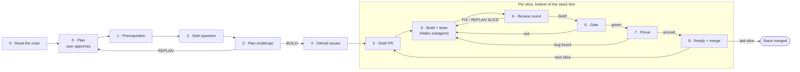

# coding-workflow

A skill for any coding agent that ships features as a stack of small,
reviewed pull requests.

The agent reads the code, plans first, tracks each slice in a GitHub issue,
and delivers one vertical slice per stacked PR with
[`gh stack`](https://github.com/github/gh-stack). A Haiku subagent writes the
code for each slice; the main agent does all git, PR, review, merge and proof
work. Every slice must pass lint, typecheck, test, build
and end-to-end tests, match the plan, and show proof: browser stills with a
red box on the change, and a recording when the user's path changes.

## Why

This skill is for a developer who lets an AI agent build a feature, and who
still wants to own the result.

An AI agent left alone tends to deliver one big change: many files, one
branch, one PR that no person can review well. This skill makes the agent work
the way a disciplined developer does: plan first, then small commits, one thin
slice per PR, all in a stack of PRs.

- **Structured work.** The agent follows a fixed coding workflow: plan,
  issue, draft PR, build with tests, review, gate, proof, merge. It does not
  skip steps, and every step leaves a trace on the PR.
- **Small PRs you can review yourself.** Each PR holds one slice, small
  enough to read in one sitting. You review the AI's work PR by PR, and you
  stay in control of what reaches the main branch.

## Roles

The work is split between two agents. Neither one does the other's job.

| | Main agent | Implementor subagent |
|---|---|---|
| Who | The agent the user talks to | A subagent on a **Haiku**-tier model, one per slice, one at a time |
| Plans | Writes the plan, interrogates the user, attacks its own plan | Never |
| Code | Writes the brief: plan section, exact files, exact commands | Edits files and writes tests from the brief, and nothing else |
| Commands | Re-runs the gate itself before trusting it | Runs only the lint, typecheck, test and build commands named in the brief, and reports the raw output |
| Git and GitHub | Does all of it: branch, commit, push, issue, PR, comments, ready, merge, close | Never runs git, `gh` or `gh stack` |
| Review | Reviews every diff cold and posts the round on the PR | Never reviews, and never spawns agents |
| Proof | Checks the slice against the plan, uses the app in a browser, captures red-boxed stills | Never captures proof |

Why the split:

- **Cheap hands, careful head.** Haiku is fast and cheap enough to write
  each slice. Every decision that is hard to undo stays with the stronger
  main agent: the plan, git history, merges, and the claim that a slice is
  done.
- **No silent damage.** A subagent that can run git or `gh` can push to the
  wrong base, merge too early or rewrite history, and the main agent learns
  about it only from a summary. With no git access, its worst outcome is a
  bad diff, which the main agent reads before anything leaves the machine.
- **Review that is not self-review.** The implementor never judges its own
  work. The main agent reads the diff as if someone else wrote it.

The loop for each slice:

1. The main agent writes the brief.
2. The subagent implements it and reports a diff summary and gate output.
3. The main agent reads the diff and re-runs the gate.
4. If anything is wrong, the main agent sends a fix brief back to the subagent.
5. When the slice is clean, the main agent commits, opens the PR, reviews,
   proves, checks that the PR base is the integration branch, and merges.

## Credits

Co-authored by **RealtaNua** ([Nael-Nathanael](https://github.com/Nael-Nathanael)).

Some ideas in this skill come from the
[ship-pr](https://github.com/Nael-Nathanael/ship-pr/tree/main) skill by
[Nael-Nathanael](https://github.com/Nael-Nathanael):

| This skill | Idea from |
|---|---|
| PR body in `references/create-pr.md` | [PR template](https://github.com/Nael-Nathanael/ship-pr/blob/main/skills/ship-pr/references/pr-template.md) |
| Reviewer prompts in `references/pr-review.md` and `references/plan-challenge.md` | [Challenge brief](https://github.com/Nael-Nathanael/ship-pr/blob/main/skills/ship-pr/references/challenge-brief.md) |
| Plan shape and design questions in `references/slice-plan.md` | [Plan template](https://github.com/Nael-Nathanael/ship-pr/blob/main/skills/ship-pr/references/plan-template.md), [design principles](https://github.com/Nael-Nathanael/ship-pr/blob/main/skills/ship-pr/references/design-principles.md) |
| Browser stills with red boxes in `references/proof-capture.md` | [Evidence](https://github.com/Nael-Nathanael/ship-pr/blob/main/skills/ship-pr/references/evidence.md) |
| Test levels in `references/test-levels.md` | [Testing](https://github.com/Nael-Nathanael/ship-pr/blob/main/skills/ship-pr/references/testing.md) |
| Read-first, prove and blocked-stage rules in `SKILL.md` | [SKILL.md](https://github.com/Nael-Nathanael/ship-pr/blob/main/skills/ship-pr/SKILL.md) |

## Pipeline



| # | Stage | Guide |
|---|---|---|
| 0 | Read the code, then write a plan the user approves, settled by interrogation | `references/slice-plan.md`, `references/interrogating.md` |
| 1 | Prerequisite check | `scripts/prerequisite.sh` |
| 2 | Start question: existing GitHub issue | `SKILL.md` |
| 3 | Main agent attacks its own plan | `references/plan-challenge.md` |
| 4 | Write or update the issue | `references/write-or-update-ticket.md` |
| 5 | Open the stacked PR as a draft | `references/create-pr.md` |
| 6 | Build with tests, review rounds, gate | `references/workflow.md`, `references/test-levels.md`, `references/pr-review.md` |
| 7 | Prove: against the plan, as a user, with red-boxed stills | `references/workflow.md`, `references/proof-capture.md` |
| 8 | Mark ready, merge, close the issue, go to the next slice | `references/workflow.md`, `references/create-pr.md` |

Stages 5 to 8 repeat slice by slice until the last PR is merged. Only the
code-and-tests part of stage 6 belongs to the subagent; every other stage
belongs to the main agent (see [Roles](#roles)).

Rules the skill enforces:

- **No plan, no start.** The agent stops until the user approves a plan.
- **Tickets first.** Every slice has a GitHub issue, made with `gh issue`.
  Status is a label; the issue is closed when the PR merges.
- **Always `gh stack`.** One vertical slice per branch and PR. The stack is
  kept in sync after every change.
- **Split roles.** One Haiku subagent per slice only implements what the
  main agent's brief says: no git, no `gh`, no merge, no proof. The main
  agent reviews every diff, runs the gate, commits, opens and merges PRs,
  and captures the proof.
- **Proof, not claims.** Every "done when" item points at a test, a terminal
  output or a still with a red box. Proof is uploaded to the PR with
  `gh pr edit --attach` and checked to render.
- **One e2e run at a time.** Concurrent runs against a shared database corrupt
  each other's fixtures.

## Works with any coding agent

Nothing in the skill depends on one agent. Where an agent has a feature, the
skill uses it; where it does not, the skill names a plain fallback:

| Skill needs | With the feature | Without it |
|---|---|---|
| Plan approval | The agent's plan mode | Plan in `$WORK/plan.md`, no other edits until the user approves |
| Start question | The agent's question tool | Ask in chat and wait |
| Build checklist | The agent's task list | Checklist in `$WORK/plan.md` |
| Browser | Browser tools such as a Playwright MCP server | The Playwright script in `references/proof-capture.md` |
| Staying on target | A standing goal, such as `/goal` in Claude Code | Skip it |
| Implementor | A subagent on a Haiku-tier model | The main agent implements, and the PR says so |

## Requirements

- A coding agent that can run shell commands.
- [GitHub CLI](https://cli.github.com), logged in (`gh auth login`)
- The `gh stack` extension:

  ```bash
  gh extension install github/gh-stack
  ```

- For UI work: `gh` 2.99.0 or later, Node.js, Playwright and ffmpeg
  (`prerequisite.sh --ui` checks them).

## Install

With the [skills.sh](https://skills.sh) CLI:

```bash
npx skills add oriastanjung/coding-workflow-skills
```

Or copy `skills/coding-workflow/` into the folder where your agent loads
skills. An agent with no skill support can use it too: tell it to read
`skills/coding-workflow/SKILL.md` and follow it.

Check the prerequisites from the project's repository:

```bash
bash <skill folder>/scripts/prerequisite.sh        # add --ui for UI work
```

## Usage

1. Describe the feature. Use the agent's plan mode if it has one. Answer the
   interrogation rounds until every decision is settled, then approve the
   plan.
2. Optional: if your agent supports a standing goal, set it to the plan's
   objective.
3. Invoke the skill (for example `/coding-workflow`), or ask the agent to
   follow `SKILL.md`.
4. Answer the start question. The main agent then works the stack slice by
   slice, briefing one Haiku subagent per slice and doing every git, PR,
   review, merge and proof step itself.

## Layout

```
skills/coding-workflow/
├── SKILL.md
├── scripts/
│   └── prerequisite.sh
└── references/
    ├── interrogating.md
    ├── slice-plan.md
    ├── plan-challenge.md
    ├── write-or-update-ticket.md
    ├── workflow.md
    ├── test-levels.md
    ├── pr-review.md
    ├── proof-capture.md
    └── create-pr.md
```

## License

[MIT](LICENSE.md)
